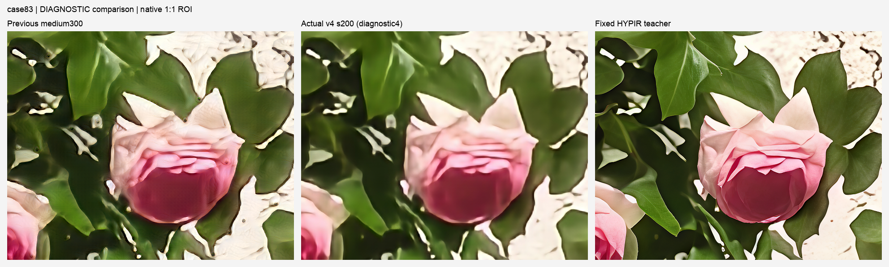

# 独立 SR、HYPIR NR 优化与 PixG5i 蒸馏实验总交接

归档日期：2026-10-15。范围为 10-10—10-15 的本地留存证据和 30416 服务器元数据快照；更早的 CSIG 提交历史继续保留在仓库原有 `docs/`。这是离线实验归档，工具预测分不等于官方榜分。

## 当前结论

- **HYPIR 教师当前选择**：`push7_a7750_lastres_lr5e6_nr_s7850_trtunetvae_all`，raw SHA256 `23de1a93b1ddd72a268788bebbdd8ba348b2819bc35cfa6a4501ffc822fdc06c`。完整 103 图 / 418 指标，NR **2.3267079147**、FR **1.4491248528**、质量 S **3.7758327675**；恢复后同轮单 A100 512×512 event-p10 **32.789505 ms**，原工具经验预测 **61.203792**，**未达到 65**。历史 62.953695 使用另一实例/校准批次，不能与 61.203792 直接作增益比较。
- **PixG5i 主模型未被最新实验覆盖**。用户提供包中的原始小网络仍是 PixUNet2，3,786,764 参数。最新 `coverage_v4_s200` 的 NR **1.4365553288**、FR **1.3494069576**、S **2.7859622864**，假纹理减少但字形、细杆、叶脉偏软；结构验收和完整质量均未胜出，停在本阶段实际 **200 步**，不是计划上限 2000 步。
- 最新失败候选没有正式测速，**没有工具总分预测**；不得给它拼接旧模型速度。之前 `medium300` 已实际出图、完整评分并打包，S **3.7796775959**，当时同轮五 fresh 进程工具预测 **122.164437**，仍有用户指出的伪影，不能称最终画质合格。
- HYPIR 优化时按用户要求保持教师身份；之后用户明确指定包内 PixG5i 为学生，才单独做固定 HYPIR 伪标签蒸馏。学生训练没有改动该教师指针，不能把这两段授权范围混为一谈。
- 本次现场快照时 **训练和评分均已停止，4 张 A100 没有 GPU 计算进程**。状态和路径只对快照时刻有效。

直接证据：[当前教师指针](archive/server_cuda30416/results/current_model_preference.json)、[HYPIR 最终状态](archive/server_cuda30416/results/status_push7_20261015.json)、[学生最终状态](archive/server_cuda30416/results/status_pixg5i_distill_20261015.json)、[最新 103 图审计](archive/server_cuda30416/audits/pixg5i_distill/coverage_v4_s200_full.json)、[现场资源快照](archive/server_cuda30416/LIVE_RESOURCE_SNAPSHOT.json)。

## 从哪里读起

| 文档/索引 | 包含内容 |
|---|---|
| [独立 SR 历史](INDEPENDENT_SR_HISTORY.md) | 原始模型比较、23 版完整评分、HYPIR/PromptIR/VOSR2 伪标签训练、历史多教师重评、昇腾阶段和迁移 |
| [HYPIR NR 优化历史](HYPIR_NR_HISTORY.md) | 6000 步参数搜索、Push1—7、编译/TensorRT、视觉退回、实例重置恢复、最新 6 张 LoRA 受限更新 |
| [PixG5i 蒸馏设置和全部版本](PIXG5I_DISTILLATION.md) | 架构、损失、学习率、数据/裁剪、优化器/RNG、5 阶段血缘、14 个版本、失败决策和备份 |
| [服务器、端口和模型位置](PORTS_AND_MODEL_LOCATIONS.md) | 当前连接方式、历史端口、目录、模型/恢复状态和存储边界 |
| [23 版初始结果 JSON](independent_sr_round2_versions.json) | 原报告显示精度的六指标、NR/FR/S及明确记载的官方分 |
| [HYPIR 版本 JSON](HYPIR_HISTORY_VERSIONS.json) / [CSV](HYPIR_HISTORY_VERSIONS.csv) | 55 条分协议/批次证据记录；含对照和重复来源，不能当作55个独立实验相加 |
| [PixG5i 版本 JSON](pixg5i_versions.json) | 14 个实际版本，10 个完整评分，4 个未全量评分保持 null；3 个有同轮正式计时 |
| [模型位置索引](registry/model_locations.json) / [端口 JSON](registry/ports.json) | 当前选择和全部已注册候选的源路径、SHA、清单与证据入口 |

## 训练与评分如何区分

质量部分统一写清样本及协议，主要公式是：

```text
NR = mean(CLIPIQA_test100) + mean(MANIQA_test100)
     + mean(MUSIQ_test100)/100 + max(0,(10-mean(NIQE_test100))/10)
FR = 2 - mean(LPIPS_val3) - mean(DISTS_val3)
S_full = NR + FR
```

完整为 test100 + validation3，103 张图、418 个标量；20-test + 3-val 的 pilot 只记 `S_subset`。原始 round2 JPEG/逐图重置种子、昇腾 NPU、后来 CUDA FP16/round-PNG/按 split 连续 RNG 属于不同协议，不在一个不加说明的排行榜中混排。MANIQA 正式评分为 100 crops；训练代理裁剪数与正式评分分开记录。

CUDA 正式速度采用独立 fresh 进程、同一物理单卡、512×512 FP16 输入、seed231、warm30 + n200、CUDA event p10；**不是 4K 原图耗时**。原工具 `predict.py` 与同批 G4 参考另行绑定；首尾 G4 的共同保守 min 在测量前约定。任何后端/引擎改变像素的模型都需要自己的完整质量证据，不能借用另一版本的评分。

这些训练使用 test100 输入做无 GT 适应，验证 GT 未参与训练；test100 参与适配和选型，结果不能被解释为独立未见测试集泛化。最新学生的教师固定为 raw23de 对应的原尺寸 PNG，不在部署时调用 HYPIR，不混合教师推理输出。

## 原样保存的实验设置、代码和逐图证据

- [本地历史元数据快照](archive/local/score_search/)：NR 报告、自研训练/推理/评分/归档脚本、配置、逐图 JSONL、审计、校准记录等；原文件字节与源 SHA 保持一致。
- [当前服务器代码](archive/server_cuda30416/code/)：包含 HYPIR CUDA/TensorRT 支持和 PixG5i 各阶段训练、登记、出图、评分与审计源码。
- [最新 HYPIR 训练配置](archive/server_cuda30416/adaptation/runs/hypir_push7_A7750_lastres_lr5e6_nr100/config.json)及同目录训练日志、checkpoint 标记、初始化/梯度证明。
- [学生全部 run 配置/日志](archive/server_cuda30416/experiments/pixg5i_hypir_distill_20261015/runs/)：mild、medium、structure_v2、headreset_v3、coverage_v4，保留实际采样计划和局部/累计步数。
- [学生精确 CLI 和原始训练源码](archive/server_cuda30416/code/pixg5i_hypir_distill/)；[候选注册清单](archive/server_cuda30416/submissions/)记录部署内容、父检查点和训练来源。
- [学生完整评分](archive/server_cuda30416/nr_pixg5i_distill_full_evaluations/)和[当前教师完整评分](archive/server_cuda30416/nr_push7_recovered_full_evaluations/)：保留 result、measurements、protocol、render manifest；原尺寸 PNG 留在服务器，不把它们当成已上传数据。
- [质量审计](archive/server_cuda30416/audits/)、[正式计时原始记录](archive/server_cuda30416/calibration/)及[实际运行日志](archive/server_cuda30416/logs/)。
- [初始完整中文报告](history_sources/round2/实验报告_指标与微调及视觉案例.md)和13张原始拼图；它引用但本地未留存的早期 CSV、源码等不虚构补齐。

## 代表图

最新 PixG5i：左为此前 medium300，中为 coverage_v4_s200，右为固定 HYPIR 教师。1:1 ROI，无重采样、锐化或 AI 改图。四张诊断图与正式 full103 相应 PNG 的 SHA 和 ROI 像素均已核对相同，见[独立证明](visuals/pixg5i_latest_vs_previous_teacher/full_diag_equivalence.json)。



[文字](visuals/pixg5i_latest_vs_previous_teacher/case7_diagnostic_structure_ROI_1to1.png) · [栏杆](visuals/pixg5i_latest_vs_previous_teacher/case16_diagnostic_structure_ROI_1to1.png) · [花瓣/背景](visuals/pixg5i_latest_vs_previous_teacher/case41_diagnostic_structure_ROI_1to1.png) · [教师最新微调对照](visuals/hypir_selected/README.md)。

## 归档边界与复现入口

本目录上传代码、配置、训练/评分日志、指标、状态、审计、来源清单和代表图。沿用仓库已有约定，**不上传数据集、完整教师输出集、大 checkpoint/resume、TRT engine、环境、第三方整仓克隆或提交 zip**。权重路径与 SHA 在版本表、候选 manifest 和恢复回执中；这些信息不等于 GitHub 内已经包含权重。

当前 CUDA 根目录 `/cache/independent_sr_cuda_20261013`，Python 为该目录 `env/bin/python`。历史 `/cache/independent_sr_round2_20261010` 没有出现在当前恢复实例，早期 `AGENT_HANDOFF.md` 本体未在本地找到，故保留完整中文报告而不宣称找到了原交接文件。`nr_v2_strength` / `nr_v2_balanced` 的精确训练终态也缺少现有证据，标记历史待核实。

复现时先按[端口/模型文档](PORTS_AND_MODEL_LOCATIONS.md)核实实例、路径和资源，再从原位置取得与 manifest 对应的输入、指标权重、底模、LoRA 和精确恢复文件。`/cache` 可能随实例重建消失；当前 `/temp` 共享盘几乎满，本次同步没有往共享盘新增模型。旧模型/质量结果不可覆盖；最新 coverage200 的预设结构检查失败，不应把计划2000误当成已完成或自动接着跑。

来源及完整性：[本地逐文件清单](manifests/LOCAL_SOURCE_MANIFEST.json)、[服务器逐文件清单](archive/server_cuda30416/SERVER_METADATA_MANIFEST.json)、[整个发布目录清单](manifests/PUBLISHED_FILES.json)。原始历史报告保留绝对执行路径；GitHub 内查阅优先走本页相对链接和目录索引。
