# 第二轮图像增强实验报告

数据快照：2026-10-10 16:21:51（北京时间）。本文件是实验记录，不是官方评测报告。

## 1. 当前结论

- 已完整评分的版本见下表。当前综合质量代理分最高仍是旧版 `final4h_balance`；它对应已知官方成绩 **92.1755**，不是缺失的 92.9855 提交件。
- 新模型原版中，`hypir_sd2_t200` 的综合代理分最高（3.5589）；`seesr_50step` 的有参考验证集综合分最高（1.4635）。这些结果只对应本轮已测配置。
- HYPIR 使用 NR 筛选教师微调后明显下降；限制为 HYPIR/SeeSR 教师的 250/1,000 步版本，验证集综合分高于原版，但综合代理分仍下降。这是一个失败与部分改善并存的实验，不能描述成整体提分。
- PromptIR 的 NR 教师微调 1,500 步比原版略升，500 步未超过原版。尚不能把它作为当前最佳方案。
- 模型名称强、训练损失下降、图片更锐，均不自动等于该任务得分更高。以下图例保留可见问题，不只展示看起来成功的样本。

### 本次新增评分

| 新增版本 | S↑ | 相对原版 ΔS | 相对原版 ΔFR | 结论 |
| --- | --- | --- | --- | --- |
| `vosr2_nr_select_s250` | 2.8481 | +0.1090 | +0.0026 | 微调带来代理分提升，但仍低于旧版 |
| `hypir_perceptual_select_s1000` | 3.3090 | -0.2499 | +0.0145 | FR 提升，NR 下降，综合仍低于原版 |
| `promptir_perceptual_select_s500` | 2.3770 | -0.0371 | +0.0013 | 未超过原版 |
| `promptir_perceptual_select_s1500` | 2.3954 | -0.0187 | +0.0024 | 未超过原版 |

本次报告共纳入 **23 个完整评分版本**。新增结果不替代原版与历史对照；未完成项目见第 6 节。

## 2. 每个已完成版本的指标

NIQE、LPIPS、DISTS 越低越好；其余指标及 NR、FR、S 越高越好。NR 指标是测试集 100 张均值，LPIPS/DISTS 是有 GT 验证图 3 张均值。

| 版本 | NIQE↓ | MUSIQ↑ | MANIQA↑ | CLIPIQA↑ | LPIPS↓ | DISTS↓ | NR↑ | FR↑ | S↑ | 已知官方总分 |
| --- | --- | --- | --- | --- | --- | --- | --- | --- | --- | --- |
| `final4h_balance` | 3.6902 | 56.5761 | 0.6269 | 0.8737 | 0.3839 | 0.2946 | 2.6973 | 1.3216 | 4.0189 | 92.1755 |
| `pushv2_teacher_quality` | 4.1641 | 50.8571 | 0.5267 | 0.8399 | 0.3440 | 0.2724 | 2.4588 | 1.3837 | 3.8424 | 75.6735 |
| `hypir_sd2_t200` | 3.8985 | 42.9313 | 0.4133 | 0.6627 | 0.3554 | 0.2012 | 2.1155 | 1.4434 | 3.5589 | — |
| `seesr_50step` | 4.6506 | 43.3711 | 0.4244 | 0.6568 | 0.3294 | 0.2072 | 2.0499 | 1.4635 | 3.5133 | — |
| `hypir_perceptual_select_s1000` | 4.8814 | 40.5324 | 0.3683 | 0.5656 | 0.3304 | 0.2116 | 1.8511 | 1.4579 | 3.3090 | — |
| `hypir_perceptual_select_s250` | 5.0724 | 40.1402 | 0.3579 | 0.5649 | 0.3387 | 0.2154 | 1.8171 | 1.4459 | 3.2630 | — |
| `invsr_3step` | 5.1701 | 38.5141 | 0.3676 | 0.5538 | 0.4237 | 0.2660 | 1.7895 | 1.3103 | 3.0998 | — |
| `hypir_nr_select_s250` | 5.3605 | 37.2783 | 0.3185 | 0.5070 | 0.3718 | 0.2377 | 1.6622 | 1.3905 | 3.0527 | — |
| `hypir_nr_select_s1000` | 5.3803 | 37.5769 | 0.3253 | 0.5060 | 0.3670 | 0.2500 | 1.6690 | 1.3830 | 3.0520 | — |
| `realesrgan_x4_native` | 6.1469 | 39.7880 | 0.3623 | 0.4923 | 0.3892 | 0.2819 | 1.6378 | 1.3289 | 2.9667 | — |
| `realesrgan_x2_native` | 5.7027 | 39.1290 | 0.3268 | 0.4757 | 0.3864 | 0.2732 | 1.6235 | 1.3403 | 2.9639 | — |
| `vosr2_nr_select_s250` | 5.8455 | 34.3981 | 0.2610 | 0.4403 | 0.3571 | 0.2556 | 1.4607 | 1.3873 | 2.8481 | — |
| `real_hat_gan_native` | 6.7259 | 38.2214 | 0.3205 | 0.4462 | 0.3940 | 0.2918 | 1.4763 | 1.3141 | 2.7905 | — |
| `vosr2_public_native` | 6.3403 | 33.6670 | 0.2699 | 0.3818 | 0.3590 | 0.2563 | 1.3544 | 1.3847 | 2.7391 | — |
| `vosr2_nr_select_s1000` | 6.4761 | 32.9269 | 0.2602 | 0.4177 | 0.3866 | 0.2733 | 1.3596 | 1.3401 | 2.6998 | — |
| `supir_q_50step` | 5.3948 | 34.3558 | 0.2559 | 0.4030 | 0.5416 | 0.3167 | 1.4630 | 1.1417 | 2.6047 | — |
| `foundirv2_20step_native` | 6.2705 | 31.3504 | 0.2303 | 0.3087 | 0.4477 | 0.2697 | 1.2254 | 1.2826 | 2.5080 | — |
| `promptir_nr_select_s1500` | 7.4387 | 33.0476 | 0.2706 | 0.3205 | 0.4095 | 0.2917 | 1.1777 | 1.2988 | 2.4765 | — |
| `promptir_public_native` | 7.1762 | 30.8900 | 0.2505 | 0.2937 | 0.4296 | 0.2917 | 1.1355 | 1.2787 | 2.4142 | — |
| `promptir_perceptual_select_s1500` | 7.6704 | 31.5494 | 0.2629 | 0.3030 | 0.4233 | 0.2957 | 1.1144 | 1.2811 | 2.3954 | — |
| `promptir_nr_select_s500` | 7.4998 | 30.8033 | 0.2616 | 0.2877 | 0.4239 | 0.2918 | 1.1073 | 1.2843 | 2.3916 | — |
| `promptir_perceptual_select_s500` | 7.5026 | 30.5778 | 0.2588 | 0.2828 | 0.4264 | 0.2936 | 1.0971 | 1.2799 | 2.3770 | — |
| `input_unmodified` | 7.4095 | 30.3356 | 0.2559 | 0.2786 | 0.4261 | 0.2937 | 1.0968 | 1.2802 | 2.3770 | — |

注意：SSIM/PSNR **没有纳入本次测量**，表中未填造这些数值。测试 100 张没有真实参考图，不能把与输入或教师的 SSIM 当成真实恢复质量；如后续计算，应单独标明比较对象。

### 微调相对原版的变化

| 微调版本 | ΔNR | ΔFR | ΔS |
| --- | --- | --- | --- |
| `hypir_nr_select_s1000` | -0.4465 | -0.0604 | -0.5069 |
| `hypir_nr_select_s250` | -0.4533 | -0.0529 | -0.5062 |
| `hypir_perceptual_select_s1000` | -0.2644 | +0.0145 | -0.2499 |
| `hypir_perceptual_select_s250` | -0.2985 | +0.0025 | -0.2959 |
| `promptir_nr_select_s1500` | +0.0422 | +0.0201 | +0.0624 |
| `promptir_nr_select_s500` | -0.0282 | +0.0057 | -0.0225 |
| `promptir_perceptual_select_s1500` | -0.0212 | +0.0024 | -0.0187 |
| `promptir_perceptual_select_s500` | -0.0384 | +0.0013 | -0.0371 |
| `vosr2_nr_select_s1000` | +0.0053 | -0.0446 | -0.0393 |
| `vosr2_nr_select_s250` | +0.1064 | +0.0026 | +0.1090 |

## 3. 分数具体怎么算

评分依据是保留下来的质量评分代码快照 [`csig_metrics.py`](../scoring_tool_snapshot/csig_metrics.py) 中的指标定义；实际本轮执行器是 [`calibrate.py`](../calibrate.py) 和 [`run_metric_study.py`](../run_metric_study.py)。它是多个公开 IQA 指标的组合，不是一个单独的“评分大模型”。旧脚本中的官方总分拟合器没有用于这里的结果。

### 3.1 汇总公式

先分别计算 100 张测试图的四个无参考指标均值，记作 C、M、U、N；3 张验证图分别与自己的 GT 比较，得到 LPIPS 均值 L 和 DISTS 均值 D。

```text
NR = C + M + U / 100 + max(0, (10 - N) / 10)
FR = (1 - L) + (1 - D) = 2 - L - D
S_proxy = NR + FR
```

例如旧版 `final4h_balance`：

```text
NR = 0.8736599 + 0.6268955 + 56.5760583/100
     + max(0, (10-3.6901874)/10) = 2.6972972
FR = 2 - 0.3838704 - 0.2945714 = 1.3215581
S_proxy = 4.0188553
```

这里 **不含速度项，也没有经过官方总分拟合**。不能从 4.0189 推出比赛必得多少分。已知的两个官方成绩只用于检验排序是否一致，不能建立可靠换算关系。

### 3.2 实际测量协议

- 所有候选使用同一套输入：100 张无 GT 测试图与 3 对有 GT 验证图。验证图从不进入本轮训练。
- 测量 PyIQA 0.1.10 的 `niqe`、`musiq`、`maniqa`、`clipiqa`、`lpips`、`dists`；MANIQA 使用 KonIQ 检查点，而非 MANIQA-PIPAL。
- 每张图、每个指标重置随机种子为 1234。NR 使用 FP32；LPIPS/DISTS 使用 FP16 autocast。关闭 TF32 与 cuDNN benchmark。
- MANIQA 每图 100 次随机裁剪，按 4 个一组计算，并按模型权重聚合，不能简单取各组分数的平均。
- MUSIQ 保留原生图像 token，采用分块计算降低显存占用；此前与原实现的等价性检查差异为 3.82e-6。
- 旧版保留 JPEG 原字节；新模型原始 PNG 保留服务器，评分时统一转换为 JPEG quality=100、subsampling=0。若模型输出尺寸不同，先 Lanczos 缩回输入尺寸。该协议比较的是本任务输出尺寸，不是所有模型的原生放大效果。
- 原版与微调版之间使用相同推理配置和评分协议。只有 3 张验证图，不能据此断言所有场景泛化更好。

### 3.3 可重复性检查

已对两份历史版本的前 5 张测试图和 3 张验证图做同种子复算，并增加 2345/3456 两个种子。固定种子的各指标复算最大绝对差为 0。MANIQA 在不同种子下会波动：旧版前 5 图的三种子标准差均值为 0.01338，另一份历史版本为 0.01550。它们是子集波动估计，不是全量综合分的置信区间。详见 [`stability_report.json`](stability_report.json)。

## 4. 微调数据、教师筛选与训练方法

### 4.1 两种教师策略

训练对为测试原始输入 x 与伪标签教师图 y；不是测试 GT。每种教师策略在训练前固定，并保存逐图选择记录。没有把新微调结果循环写回本轮教师库。

1. **`nr_select`**：候选为本队两份历史输出、公开 HYPIR 原版、公开 SeeSR 原版。逐图选择 NR 代理分最高的候选。
2. **`perceptual_select`**：候选仅为公开 HYPIR 与 SeeSR，仍按逐图 NR 分选择。这个目录名是实验标签，**不意味着使用了真实感知 GT 或已经证明是最优视觉教师**。

- `nr_select` 实际分配：`final4h_balance` 95 张；`hypir_sd2_t200` 2 张；`pushv2_teacher_quality` 3 张。
- `perceptual_select` 实际分配：`hypir_sd2_t200` 62 张；`seesr_50step` 38 张。

逐图筛选使用 `NR_i = CLIPIQA_i + MANIQA_i + MUSIQ_i/100 + max(0,(10-NIQE_i)/10)`。注意：这里在每张图上截断 NIQE 项，而汇总评分是在 NIQE 均值之后截断；两者不应混为同一个总分。

### 4.2 共同训练设置

- 数据：公开测试 100 图的输入—伪标签配对；无验证集训练、无 GT 泄漏。公开测试输入适配的参赛资格尚未获得主办方确认，须与普通训练/原版对照分开记录。
- 空间对齐：输入与教师尺寸必须一致，随机同位置裁剪，并同步随机水平/竖直翻转。没有把相邻 case 直接拼贴作为本轮训练教师。
- 随机种子 20261010；AdamW，weight_decay=0；BF16 autocast；梯度范数裁剪上限 1。
- 图像归一化至 [0,1]。`L1` 是逐像素绝对误差均值；`gradient` 是水平/竖直一阶差分误差的平均，详见 [`adaptation_data.py`](../adaptation_data.py)。

### 4.3 HYPIR：已有公开 LoRA 上继续微调

- 初始化：公开 HYPIR SD2 权重，SD2.1-base 底座；LoRA rank=256，model_t=coeff_t=200。优化器只更新 LoRA 参数，已对早期检查点验证 514 个 LoRA 张量发生改变且数值有限。
- 两种教师策略各从同一公开起点独立训练 1,000 步，保留 250/1,000 步；不是在第一策略权重上续训第二策略。
- batch=2，patch=256，lr=2e-6；UNet 梯度检查点开启；VAE 编码取 latent distribution 的 mode。
- 损失：`L = L1(pred,y) + 0.05*LPIPS(pred,y) + 0.1*gradient(pred,y)`。LPIPS 网络不更新，VAE 编码在 no_grad 下执行。
- 推理：upscale=1，patch=512、stride=256，空文本提示，seed=231。
- 实现：[`train_hypir_adapt.py`](../train_hypir_adapt.py)；服务器检查点：`/cache/independent_sr_round2_20261010/adaptation/runs/hypir_adapt_<policy>/step{250,1000}.pth`。

### 4.4 PromptIR：全参数微调

- 初始化：DeepInv 公开 PromptIR 检查点；已严格加载进官方 `PromptIR(decoder=True)` 架构。HF 版本 `9c27b4db627f3fb725166ae6366696e4e61349e9`。不能称它与另一份 GitHub release 文件逐字节相同。
- 两种教师策略分别独立训练 1,500 步，保留 500/1,500 步。全网络优化，batch=4，patch=192，lr=1e-5。
- 损失：`L = L1(pred,y) + 0.1*gradient(pred,y)`；没有使用 GAN 判别器或感知损失。
- 推理：原尺寸 x1，tile=256，overlap=64，高斯加权拼接，BF16。
- 实现：[`train_aio.py`](../train_aio.py)、[`infer_aio.py`](../infer_aio.py)；服务器检查点：`/cache/independent_sr_round2_20261010/adaptation/runs/promptir_<policy>/step{500,1500}.pth`。

### 4.5 VOSR2：仅微调末端 DiT 层

- 初始化：公开 `CSWRY/VOSR` 的 VOSR2 原始权重，HF revision `f24b3061b7f350b81e1907bdcfc27f71fb4ff3f3`，使用原配 Qwen-Image 2D VAE 与 DINOv2-L。
- 训练末 6 个 DiT block 和 final_layer；其他 DiT 参数、VAE、DINO 冻结。nr_select 策略，1,000 步，保留 250/1,000 步；batch=1、patch=256、lr=1e-6。
- 单步 flow 形式：输入拼接 LQ latent 与随机 noise，预测 u，输出 latent=noise-u；按原配 VAE mean/std 编解码。
- 损失：`L = L1(RGB_pred,y) + 0.1*L1(latent_pred,latent_teacher) + 0.05*gradient(RGB_pred,y)`。
- 推理：upscale=1，DiT tile=768/overlap=128，VAE tile=512/overlap=64，seed=231。
- 训练已完成，检查点已保留；DINO 联网加载故障已修复。250 步版全量代理分 **2.8481**，相比原版 **2.7391** 提升 **0.1090**。1,000 步版评分也已完成，S=2.6998，相对原版 ΔS=-0.0393。这些是本地代理分结果，未有官方成绩验证。
- 实现：[`train_vosr2_adapt.py`](../train_vosr2_adapt.py)；检查点：`/cache/independent_sr_round2_20261010/adaptation/runs/vosr2_adapt_nr_select/step{250,1000}/ema_model.safetensors`。

### 4.6 MoCE-IR 与其他模型

- MoCE-IR：原始权重未到，**尚未训练或评分**。已准备的配方为全参数 AdamW，batch=4、patch=192、lr=1e-5、1,500 步；损失计划为 L1+0.1*gradient+0.01*官方 balance loss。权重到达后须先核对架构与损失接口，不能把准备代码写成已完成实验。
- FoundIR-v2、SUPIR、InvSR、DiffBIR、SeeSR、RealESRGAN、RealHATGAN：本轮已安排的主要是公开原版推理，尚无这些模型的本轮微调成果。

## 5. 原版推理配置与来源

| 模型 | 本轮关键配置 | 公开工程 |
| --- | --- | --- |
| HYPIR | SD2; t=200; rank256; patch512/stride256; empty caption; seed231 | [XPixelGroup/HYPIR](https://github.com/XPixelGroup/HYPIR) |
| SeeSR | 50 steps; CFG5.5; process_size512; RAM/DAPE; upscale1; seed231 | [cswry/SeeSR](https://github.com/cswry/SeeSR) |
| VOSR2 | one-step; upscale1; tile768; VAE512; seed231 | [cswry/VOSR](https://github.com/cswry/VOSR) |
| FoundIR-v2 | 20 steps; CFG5; RealVisXL4; fixed generic caption; wavelet; seed231 | [cschenxiang/FoundIR-v2](https://github.com/cschenxiang/FoundIR-v2) |
| PromptIR | x1; tile256/overlap64; BF16; DeepInv public weight | [va1shn9v/PromptIR](https://github.com/va1shn9v/PromptIR) / [weight](https://huggingface.co/deepinv/promptir) |
| MoCE-IR | waiting for original weight; strict architecture check pending | [eduardzamfir/MoCE-IR](https://github.com/eduardzamfir/MoCE-IR) |
| InvSR | SD-Turbo; 3/5 steps; chopping256; batch1; wavelet; native x4 then resize | [zsyOAOA/InvSR](https://github.com/zsyOAOA/InvSR) |
| DiffBIR | v2.1; SR upscale1; 30 steps; no captioner; tiled; seed231 | [XPixelGroup/DiffBIR](https://github.com/XPixelGroup/DiffBIR) |
| SUPIR | Q/F; 50 steps; upscale1; no LLaVA; tiled VAE; seed231 | [Fanghua-Yu/SUPIR](https://github.com/Fanghua-Yu/SUPIR) |
| RealESRGAN | x2plus/x4plus public pretrained; downsample to input size | [xinntao/Real-ESRGAN](https://github.com/xinntao/Real-ESRGAN) |
| RealHATGAN | Real_HAT_GAN_SRx4 public mirrored weight; downsample to input size | [XPixelGroup/HAT](https://github.com/XPixelGroup/HAT) |

FoundIR-v2 目前使用固定提示词 `A photo of a natural scene. Preserve faithful image structure and detail.`，没有部署 LLaVA 逐图描述，也没有声称已搜索到最优提示配置。公开原版在这些设置下的分数不代表模型所有配置的性能上限。

## 6. 未完成项目的状态

下表为快照时的生成数量；103=100 测试+3 验证。生成完成不等于评分完成。

| 版本 | 已生成 PNG | 说明 |
| --- | --- | --- |
| `diffbir_v21_30step` | 68/103 | 生成中/等待恢复，以日志为准 |
| `invsr_5step` | 28/103 | 生成中/等待恢复，以日志为准 |
| `supir_f_50step` | 43/103 | 生成中/等待恢复，以日志为准 |

MoCE-IR 未获得权重；VOSR2 已完成微调，250/1,000 步版均已评分。HYPIR 和 PromptIR 本轮队列已全部结束。旧版没有 raw_outputs PNG 计数，不能由该计数推断它没有输出。

## 7. 六组视觉 case 与逐图指标

这些 case 取自此前明确指出的问题，不是按“最容易显得好看”筛选。每组 3×3 排列：第一排原图/旧版/HYPIR 原版，第二排 SeeSR/HYPIR NR1000/HYPIR H+S250，第三排 VOSR2/PromptIR NR1500/FoundIR-v2。每格上方为全图，下方为同一个橙框区域放大。

图中 NR 是**整张测试图**的单图无参考组合分，不是框内局部分，不含 LPIPS/DISTS。FoundIR 部分为原始 PNG 预览，标为 NR pending，不能冒充已完成评分的结果。各模型使用相同归一化框、同比缩放；没有对某一模型单独锐化或修图。由于原图尺寸不同，各 case 放大倍数不同，同一 case 各模型一致。

以下观察基于这些对照图的人工复核，不是有 GT 的细节真实性结论。尤其文字与树叶，生成得更清楚不等于内容更准确。

### case7：施工横幅与脚手架

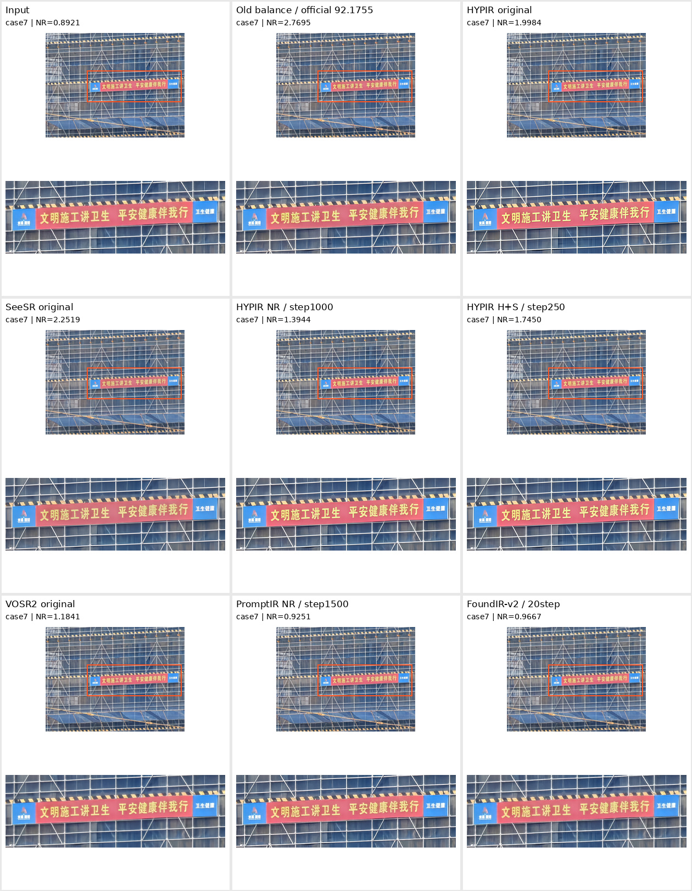

**视觉观察：**HYPIR 原版的文字边缘较利落；旧版与 SeeSR 的字边仍有较粗或不均匀的观感。细网格及斜线应同时检查重影，不能只看横幅更亮。

| 版本 | NIQE↓ | MUSIQ↑ | MANIQA↑ | CLIPIQA↑ | 单图 NR↑ |
| --- | --- | --- | --- | --- | --- |
| `input_unmodified` | 8.2044 | 25.4703 | 0.2221 | 0.2358 | 0.8921 |
| `final4h_balance` | 3.7953 | 60.9818 | 0.6521 | 0.8871 | 2.7695 |
| `hypir_sd2_t200` | 4.2374 | 29.0583 | 0.4381 | 0.6935 | 1.9984 |
| `seesr_50step` | 5.2025 | 49.1780 | 0.5138 | 0.7666 | 2.2519 |
| `hypir_nr_select_s1000` | 7.1690 | 42.2758 | 0.2858 | 0.4028 | 1.3944 |
| `hypir_perceptual_select_s250` | 6.4374 | 44.2475 | 0.3410 | 0.6052 | 1.7450 |
| `vosr2_public_native` | 7.2385 | 32.6924 | 0.2506 | 0.3304 | 1.1841 |
| `promptir_nr_select_s1500` | 8.0269 | 27.9059 | 0.2351 | 0.2137 | 0.9251 |
| `foundirv2_20step_native` | 7.5792 | 26.3390 | 0.2063 | 0.2550 | 0.9667 |

### case18：发光招牌中文字

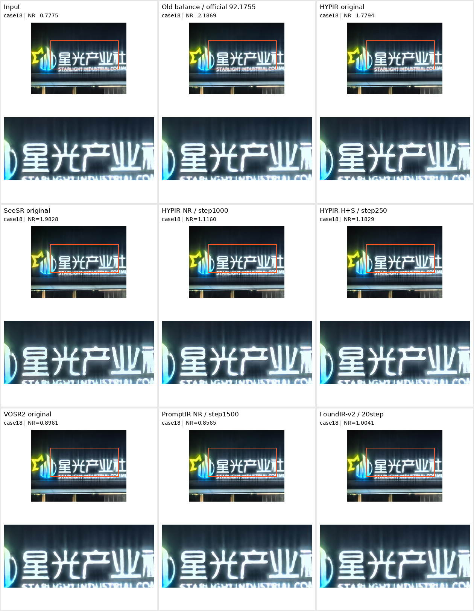

**视觉观察：**各模型都保留了发光笔画的不规则形态；HYPIR NR1000 相较原版没有显著修正字形。此例不能作为“文字被正确恢复”的证据，需继续检查具体笔画。

| 版本 | NIQE↓ | MUSIQ↑ | MANIQA↑ | CLIPIQA↑ | 单图 NR↑ |
| --- | --- | --- | --- | --- | --- |
| `input_unmodified` | 10.9025 | 17.7741 | 0.2916 | 0.3082 | 0.7775 |
| `final4h_balance` | 5.6886 | 39.5018 | 0.5005 | 0.8602 | 2.1869 |
| `hypir_sd2_t200` | 5.7558 | 40.5549 | 0.3134 | 0.6360 | 1.7794 |
| `seesr_50step` | 7.5966 | 44.2314 | 0.4984 | 0.8018 | 1.9828 |
| `hypir_nr_select_s1000` | 8.4628 | 19.7912 | 0.2735 | 0.4909 | 1.1160 |
| `hypir_perceptual_select_s250` | 8.9451 | 22.9692 | 0.2973 | 0.5504 | 1.1829 |
| `vosr2_public_native` | 9.6277 | 19.4587 | 0.3083 | 0.3560 | 0.8961 |
| `promptir_nr_select_s1500` | 9.3676 | 18.4227 | 0.3005 | 0.3086 | 0.8565 |
| `foundirv2_20step_native` | 7.8508 | 22.6619 | 0.2341 | 0.3285 | 1.0041 |

### case23：中式快餐招牌

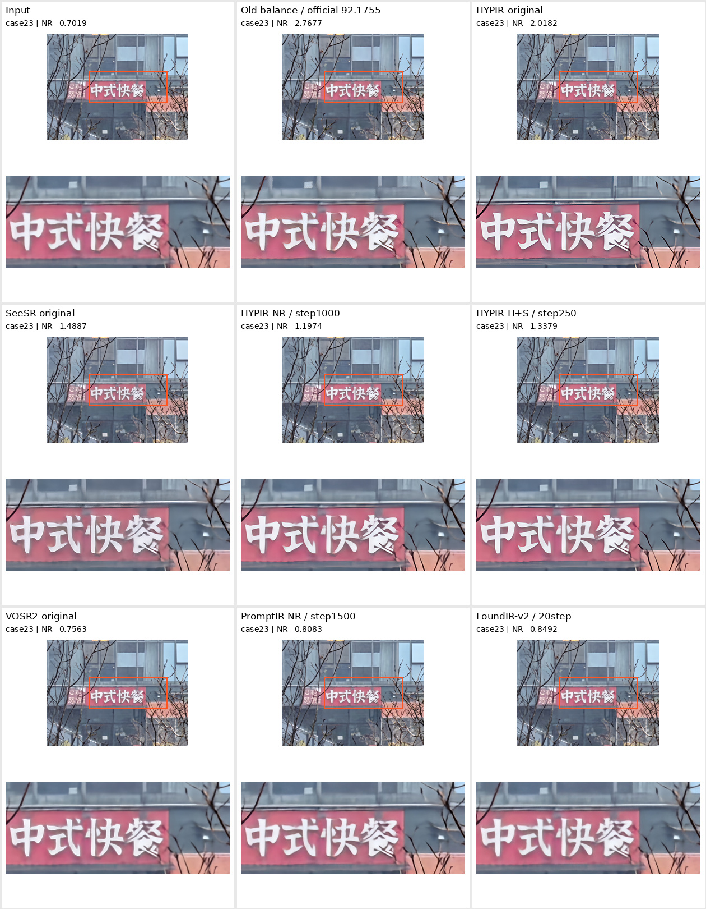

**视觉观察：**HYPIR 原版的字缘与红色招牌边界较清楚；SeeSR 部分笔画更粗，旧版仍可见粗边。主观清晰度和整体 NR 排序没有完全一致，不能据此证明整图更好。

| 版本 | NIQE↓ | MUSIQ↑ | MANIQA↑ | CLIPIQA↑ | 单图 NR↑ |
| --- | --- | --- | --- | --- | --- |
| `input_unmodified` | 9.5573 | 20.9745 | 0.2095 | 0.2384 | 0.7019 |
| `final4h_balance` | 4.3391 | 66.8076 | 0.6113 | 0.9222 | 2.7677 |
| `hypir_sd2_t200` | 4.0856 | 48.2603 | 0.3380 | 0.6062 | 2.0182 |
| `seesr_50step` | 7.2003 | 43.5216 | 0.2840 | 0.4896 | 1.4887 |
| `hypir_nr_select_s1000` | 7.3178 | 28.7923 | 0.2215 | 0.4197 | 1.1974 |
| `hypir_perceptual_select_s250` | 7.2226 | 38.1215 | 0.2733 | 0.4056 | 1.3379 |
| `vosr2_public_native` | 9.9786 | 22.7141 | 0.2365 | 0.2906 | 0.7563 |
| `promptir_nr_select_s1500` | 9.0708 | 22.1709 | 0.2228 | 0.2709 | 0.8083 |
| `foundirv2_20step_native` | 7.8579 | 18.8534 | 0.1750 | 0.2714 | 0.8492 |

### case25：中国电信标识与楼体线条

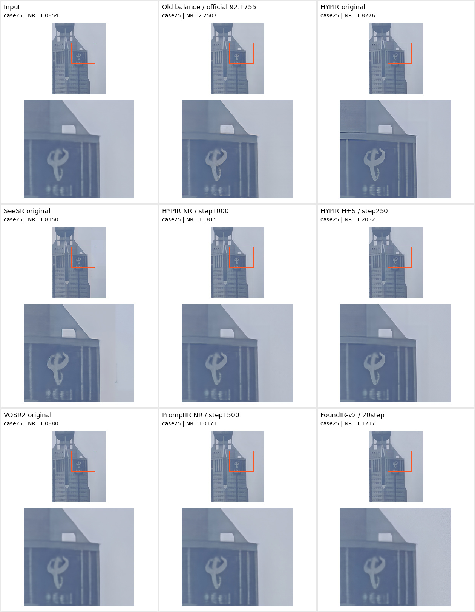

**视觉观察：**HYPIR 原版把外轮廓与标识线条刻画得更硬；但下方小字仍不可可靠辨读，不能称为恢复了正确文字。该例没有用 case24 拼贴替换 case25。

| 版本 | NIQE↓ | MUSIQ↑ | MANIQA↑ | CLIPIQA↑ | 单图 NR↑ |
| --- | --- | --- | --- | --- | --- |
| `input_unmodified` | 11.5676 | 20.4155 | 0.3946 | 0.4666 | 1.0654 |
| `final4h_balance` | 6.0344 | 44.0691 | 0.5302 | 0.8833 | 2.2507 |
| `hypir_sd2_t200` | 4.3626 | 31.7974 | 0.3793 | 0.5666 | 1.8276 |
| `seesr_50step` | 5.8536 | 27.5337 | 0.4257 | 0.6993 | 1.8150 |
| `hypir_nr_select_s1000` | 8.5568 | 23.0981 | 0.3719 | 0.4344 | 1.1815 |
| `hypir_perceptual_select_s250` | 8.0558 | 23.5217 | 0.3577 | 0.4159 | 1.2032 |
| `vosr2_public_native` | 12.8024 | 21.2126 | 0.4020 | 0.4738 | 1.0880 |
| `promptir_nr_select_s1500` | 11.5228 | 19.8479 | 0.3963 | 0.4224 | 1.0171 |
| `foundirv2_20step_native` | 8.4704 | 24.4101 | 0.3590 | 0.3657 | 1.1217 |

### case28：树冠与叶片纹理

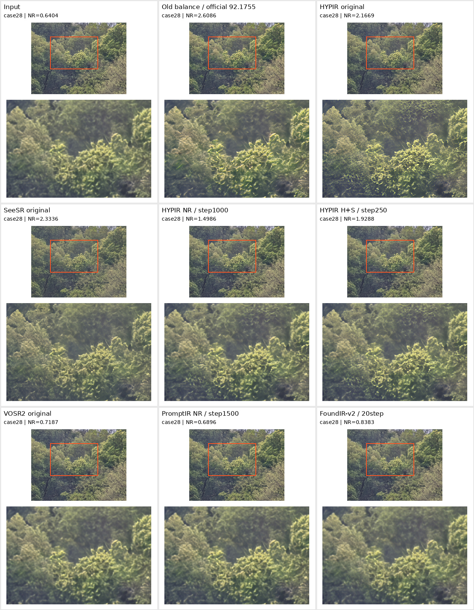

**视觉观察：**HYPIR/SeeSR 原版出现更多高频纹理；HYPIR NR1000 相比原版更软，旧版部分叶缘显得较粗。这说明蒸馏后的平滑损失值得排查；没有 GT，新增叶片纹理未必是真实细节。

| 版本 | NIQE↓ | MUSIQ↑ | MANIQA↑ | CLIPIQA↑ | 单图 NR↑ |
| --- | --- | --- | --- | --- | --- |
| `input_unmodified` | 11.5996 | 20.0789 | 0.2605 | 0.1791 | 0.6404 |
| `final4h_balance` | 5.0483 | 59.4156 | 0.5878 | 0.9315 | 2.6086 |
| `hypir_sd2_t200` | 2.7075 | 39.1694 | 0.3395 | 0.7064 | 2.1669 |
| `seesr_50step` | 3.3945 | 56.6923 | 0.4349 | 0.6712 | 2.3336 |
| `hypir_nr_select_s1000` | 6.0676 | 26.3950 | 0.2505 | 0.5909 | 1.4986 |
| `hypir_perceptual_select_s250` | 4.0048 | 33.0685 | 0.2871 | 0.7115 | 1.9288 |
| `vosr2_public_native` | 12.1779 | 17.9969 | 0.2796 | 0.2592 | 0.7187 |
| `promptir_nr_select_s1500` | 11.6879 | 18.8526 | 0.2715 | 0.2296 | 0.6896 |
| `foundirv2_20step_native` | 8.1008 | 20.6752 | 0.1962 | 0.2454 | 0.8383 |

### case41：花瓣与周围叶片

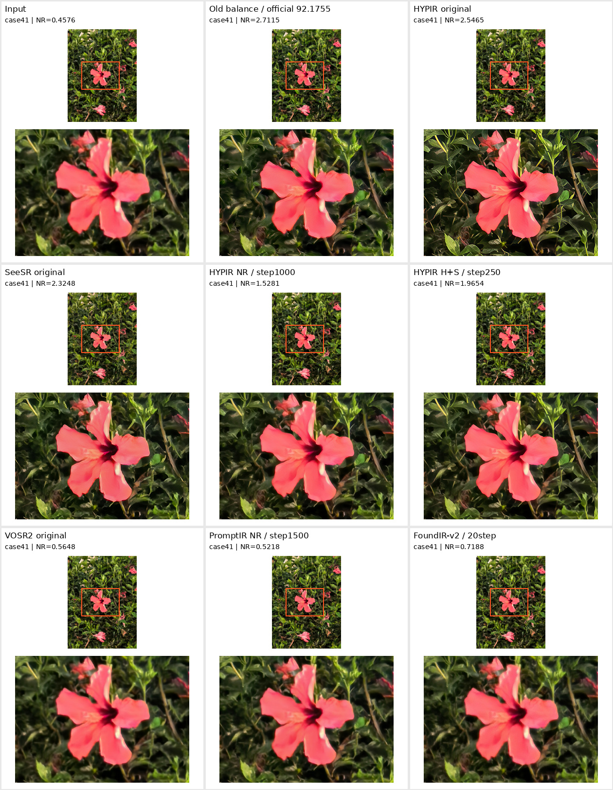

**视觉观察：**HYPIR 原版的叶片边缘较清楚，花瓣也更硬；SeeSR 的局部花瓣轮廓与输入存在观感差异，微调版整体更软。应同时检查花形是否改变，而非只比较锐度。

| 版本 | NIQE↓ | MUSIQ↑ | MANIQA↑ | CLIPIQA↑ | 单图 NR↑ |
| --- | --- | --- | --- | --- | --- |
| `input_unmodified` | 10.0547 | 16.4784 | 0.1290 | 0.1638 | 0.4576 |
| `final4h_balance` | 4.1129 | 59.0237 | 0.5898 | 0.9427 | 2.7115 |
| `hypir_sd2_t200` | 3.1407 | 52.9623 | 0.4837 | 0.8473 | 2.5465 |
| `seesr_50step` | 4.0878 | 54.0574 | 0.3883 | 0.8048 | 2.3248 |
| `hypir_nr_select_s1000` | 6.1152 | 42.1989 | 0.1749 | 0.5428 | 1.5281 |
| `hypir_perceptual_select_s250` | 5.1638 | 49.9324 | 0.2986 | 0.6839 | 1.9654 |
| `vosr2_public_native` | 11.0512 | 17.2537 | 0.1650 | 0.2273 | 0.5648 |
| `promptir_nr_select_s1500` | 9.9262 | 17.5365 | 0.1426 | 0.1964 | 0.5218 |
| `foundirv2_20step_native` | 7.0879 | 16.8368 | 0.0463 | 0.2130 | 0.7188 |

## 8. 如何复核与复现

服务器实验根目录：`/cache/independent_sr_round2_20261010`。模型权重均留在服务器，本地报告不包含大权重。

```text
assets/input/case1.jpg ... case100.jpg        测试输入
assets/validation/case*_lq.jpg, case*_gt.*   三对验证输入和 GT
assets/outputs/<label>/case*.jpg            测试评分用 JPEG
assets/validation_outputs/<label>/case*.jpg 验证评分用 JPEG
raw_outputs/<label>/                       原始模型输出
results/<label>/measurements.jsonl         逐图、逐指标、种子、耗时
results/<label>/summary.json               汇总指标与公式结果
adaptation/teachers/<policy>/selection.json 逐图教师选择
adaptation/runs/<run>/config.json          实际训练配置
adaptation/runs/<run>/                     训练权重与完成标记
logs/model_*.log                           推理/训练日志
```

在空闲 GPU 上重算某个已具备完整输出的版本：

```bash
ROOT=/cache/independent_sr_round2_20261010
CUDA_VISIBLE_DEVICES=<空闲卡号> "$ROOT/env/bin/python" \
  "$ROOT/code/calibrate.py" --label hypir_sd2_t200
```

执行器会跳过已有测量；如需独立复算，先在新的结果目录保存同协议结果，勿直接覆盖历史记录。推理的完整实际命令保存在相应日志，训练源代码链接见前文。

### 报告附件

- [`model_metrics.csv`](model_metrics.csv)：所有完整版本的汇总指标。
- [`case_metrics.csv`](case_metrics.csv)：6 组案例的逐图指标及来源。
- [`validation_metrics.csv`](validation_metrics.csv)：每个完整版本的 3 张验证图 LPIPS/DISTS。
- [`snapshot.json`](snapshot.json)：捕获时的完整汇总、状态、配置与教师选择。
- [`case_evidence.json`](case_evidence.json)：每个面板的服务器来源、框坐标与指标。
- [`measurements/`](measurements/)：各完整版本的逐图测量 JSONL 与汇总 JSON。

## 9. 下一步应验证的问题

1. **先排查微调退化，再加步数。**验证整图推理与局部裁剪训练的分布差异、教师与输入的逐像素对齐、LoRA 是否仅加载了预期参数，以及 L1 是否抹平原有纹理。它们是待验证原因，不是已定位结论。
2. **教师目标应分开实验。**目前按整图 NR 选老师，不能保证文字正确或局部叶片真实；需加入文字/线条/纹理的局部保真检查，并保留不适配测试输入的对照。
3. **等 FoundIR-v2 全量结果再决定投入。**逐图描述、推理强度与保真控制尚有搜索空间；先选有可测增益的配置，不因模型名或主观锐度大规模续训。
4. **验证数据需要扩充。**3 张验证图不足以稳定覆盖文字、建筑、植被、近景等退化；微调测试集上的 NR 提升也不等于未见图泛化提升。

## 10. 初赛阶段的多教师图：重新测量与视觉对照

本节补充的是 **2026-09-19 保存的教师图原件**，不是这轮 HYPIR/SeeSR 选图库，也不是学生推理图。已从原 AutoDL 本队目录读取并传到本轮评分服务器；原 PNG 和本次评分 JPEG 的 SHA256 均留在 [`legacy_teachers/manifest.json`](legacy_teachers/manifest.json)。

### 10.1 具体找到了哪些图

- `legacy_scene_pretext`：100 张场景配比教师，文字专项融合前。
- `legacy_scene_final`：100 张最终教师，与前一版本主要差别为 case7、23 加入 MARCONet++ 文字专项融合。
- `legacy_candidate_A/B/C`：10 张问题图的完整候选 A=BSRNet、B=BSRGAN、C=SCUNet。C 的 case41 以当时本队 192 输出为输入，而其他 C 候选以对应原始图为输入；不是完全相同输入设置的独立模型对比。
- `legacy_candidate_D*/E*`：跨视角参考迁移的少量探索候选；只对有图的 case 测量，不补造其余样本，也不称为最终教师。
- `legacy_val_*`：原先 3 张验证图的 8 种策略，包括原图、当时 192 输出、Net/GAN 的两种输入尺度及两种融合比例。

完整百图教师配方：默认 BSRGAN_s4；case16 GAN/Net 各半；case18/24/25 GAN25%+Net75%；case28/32/33 GAN75%+Net25%；case7/23 额外融合文字候选，最大权重65%。case18/24/25 的不可靠文字专家结果被拒绝，24/25 对应字形框在当时训练中避采。其余90图以通用GAN为主，没有声称对100图穷举出最优教师。逐图记录见 [`legacy_scene_final_selection.json`](legacy_teachers/legacy_scene_final_selection.json)。

### 10.2 本次重算口径

- 原始教师为 PNG；本次转换为 JPEG100/subsampling0，保持原始尺寸，无额外锐化、调色或文字修补，与当前新模型评分图编码口径一致。
- 测试图使用同一套 NIQE、MUSIQ、MANIQA、CLIPIQA，种子1234，MANIQA100裁剪，NR FP32。完整100图与局部候选子集分别统计。
- 验证图按其自己的GT计算 LPIPS、DISTS（FP16 autocast），另算 RGB PSNR 与 SSIM（Gaussian sigma1.5、population covariance、全尺寸）。
- 教师百图与验证策略没有唯一的一一对应规则，因此 **不把某个验证策略的 FR 拼到最终教师 NR 上虚构 S_proxy**。下列百图 NR 可与第2节 NR列比较，不能直接与第2节 S列比较。
- 对相同 JPEG SHA256 的图仅复用同协议测量值，保留 `reused_identical_jpeg` 标记；不是近似图分数复用。评分实现见 [`score_legacy_teachers.py`](../score_legacy_teachers.py)。

### 10.3 完整100图的无参考质量

| 教师版本 | 张数 | NIQE↓ | MUSIQ↑ | MANIQA↑ | CLIPIQA↑ | NR↑ |
| --- | --- | --- | --- | --- | --- | --- |
| `legacy_scene_final` | 100 | 5.5864 | 41.5599 | 0.3325 | 0.5437 | 1.7332 |
| `legacy_scene_pretext` | 100 | 5.5855 | 41.5761 | 0.3325 | 0.5437 | 1.7334 |

**融合前后百图变化：**NR 从 1.733370 到 1.733204，ΔNR=-0.000166。文字融合只改动 case7、23，百图均值会稀释局部变化；这不是整体换成另一套教师模型的对比。

**同一100张测试图的 NR 对照**（这里只比较 NR，不比较官方总分或 S）：

| 版本 | 百图 NR↑ |
| --- | --- |
| `final4h_balance` | 2.6973 |
| `pushv2_teacher_quality` | 2.4588 |
| `hypir_sd2_t200` | 2.1155 |
| `seesr_50step` | 2.0499 |
| `legacy_scene_final` | 1.7332 |

此次结果没有支持“旧多教师图在无参考代理分上优于本轮 HYPIR/SeeSR”的说法。局部文字的可见变化不等于整图代理分提升；百图差值极小，且没有跨种子统计检验，不能宣称显著改善。历史学生 JPEG 与本轮教师 JPEG100 的编码差异也应保留在解释中。

### 10.4 候选子集评分

A/B/C 使用同一组10图（7、16、18、23、24、25、28、32、33、41）；D/E只有表中列出的个案。不同张数的均值不可直接排名。

| 候选 | 张数 | case | NIQE↓ | MUSIQ↑ | MANIQA↑ | CLIPIQA↑ | 子集 NR↑ |
| --- | --- | --- | --- | --- | --- | --- | --- |
| `legacy_candidate_A` | 10 | 16,18,23,24,25,28,32,33,41,7 | 9.4262 | 28.6814 | 0.2796 | 0.3066 | 0.9304 |
| `legacy_candidate_B` | 10 | 16,18,23,24,25,28,32,33,41,7 | 6.3871 | 36.0559 | 0.3033 | 0.5119 | 1.5371 |
| `legacy_candidate_C` | 10 | 16,18,23,24,25,28,32,33,41,7 | 7.6643 | 33.4617 | 0.3277 | 0.4761 | 1.3720 |
| `legacy_candidate_D` | 5 | 24,25,32,33,7 | 9.0250 | 31.4078 | 0.3137 | 0.3495 | 1.0748 |
| `legacy_candidate_E` | 1 | 25 | 12.1382 | 26.0596 | 0.4045 | 0.4957 | 1.1608 |

**相同10图对照**（可与A/B/C的10图均值比较）：

| 版本 | NIQE↓ | MUSIQ↑ | MANIQA↑ | CLIPIQA↑ | 10图 NR↑ |
| --- | --- | --- | --- | --- | --- |
| `legacy_scene_pretext` | 7.5433 | 33.8653 | 0.2946 | 0.4840 | 1.3629 |
| `legacy_scene_final` | 7.5518 | 33.7028 | 0.2947 | 0.4847 | 1.3613 |
| `final4h_balance` | 4.4806 | 54.4866 | 0.5868 | 0.8927 | 2.5762 |
| `pushv2_teacher_quality` | 5.6177 | 43.0662 | 0.4375 | 0.8364 | 2.1428 |
| `hypir_sd2_t200` | 3.6838 | 41.7493 | 0.3752 | 0.6239 | 2.0482 |
| `seesr_50step` | 5.0952 | 45.2498 | 0.4130 | 0.6598 | 2.0158 |

### 10.5 三张验证图的参考指标

以下为本次重新编码后的复算，不直接照搬2026-09-19历史数字。验证图在当时用于教师策略选择，不是独立的泛化测试集。

| 策略 | 张数 | PSNR↑ | SSIM↑ | LPIPS↓ | DISTS↓ | FR↑ |
| --- | --- | --- | --- | --- | --- | --- |
| `legacy_val_gan_s4` | 3 | 24.9397 | 0.7395 | 0.3548 | 0.2359 | 1.4093 |
| `legacy_val_gan_s2` | 3 | 25.2661 | 0.7397 | 0.3641 | 0.2637 | 1.3722 |
| `legacy_val_balanced` | 3 | 25.3562 | 0.7463 | 0.3682 | 0.2601 | 1.3718 |
| `legacy_val_conservative` | 3 | 25.4739 | 0.7483 | 0.3802 | 0.2756 | 1.3442 |
| `legacy_val_net_s4` | 3 | 25.5188 | 0.7492 | 0.3915 | 0.2880 | 1.3205 |
| `legacy_val_net_s2` | 3 | 25.6076 | 0.7471 | 0.3999 | 0.2941 | 1.3060 |
| `legacy_val_current192` | 3 | 23.9590 | 0.6636 | 0.3950 | 0.3029 | 1.3021 |
| `legacy_val_raw` | 3 | 25.7887 | 0.7458 | 0.4252 | 0.2919 | 1.2829 |

**结构与纹理的取舍：**Net_s4 的 SSIM=0.7492、LPIPS=0.3915；GAN_s4 的 SSIM=0.7395、LPIPS=0.3548。应同时看像素结构与感知误差，不能仅凭一个分数选择所有场景的教师。配比属于当时任务经验，不是可学习最优路由，也未证明本身独创。

### 10.6 同区域放大对照

每组第一排：原图、BSRNet候选、BSRGAN候选；第二排：SCUNet候选、场景教师融合前、最终多教师；第三排：HYPIR、SeeSR、旧场景蒸馏学生（75.6735版）。各格都显示整图和橙框局部，NR数字是整图分数。文字策略是否正确，必须检查字形；高频树叶纹理也不等于真实细节。

#### case7：施工横幅

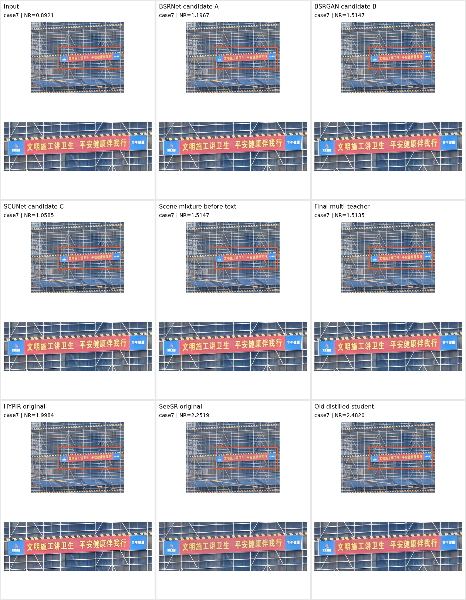

**人工复核：**重点检查横幅笔画边缘和脚手架细线；文字融合前后的变化集中在横幅，不应把整图 NR 当作文字正确率。

| 版本 | NIQE↓ | MUSIQ↑ | MANIQA↑ | CLIPIQA↑ | 单图 NR↑ |
| --- | --- | --- | --- | --- | --- |
| `input_unmodified` | 8.2044 | 25.4703 | 0.2221 | 0.2358 | 0.8921 |
| `legacy_candidate_A` | 7.9909 | 41.6139 | 0.2868 | 0.2929 | 1.1967 |
| `legacy_candidate_B` | 6.9855 | 46.1044 | 0.2991 | 0.4531 | 1.5147 |
| `legacy_candidate_C` | 7.9545 | 35.4223 | 0.2637 | 0.2360 | 1.0585 |
| `legacy_scene_pretext` | 6.9855 | 46.1044 | 0.2991 | 0.4531 | 1.5147 |
| `legacy_scene_final` | 7.0881 | 45.6439 | 0.3002 | 0.4657 | 1.5135 |
| `hypir_sd2_t200` | 4.2374 | 29.0583 | 0.4381 | 0.6935 | 1.9984 |
| `seesr_50step` | 5.2025 | 49.1780 | 0.5138 | 0.7666 | 2.2519 |
| `pushv2_teacher_quality` | 4.6266 | 53.0671 | 0.5492 | 0.8648 | 2.4820 |

文字融合前后整图 NR：1.514659 → 1.513518，变化 -0.001141。这仍然不是局部 OCR 正确率。

#### case16：建筑窗格

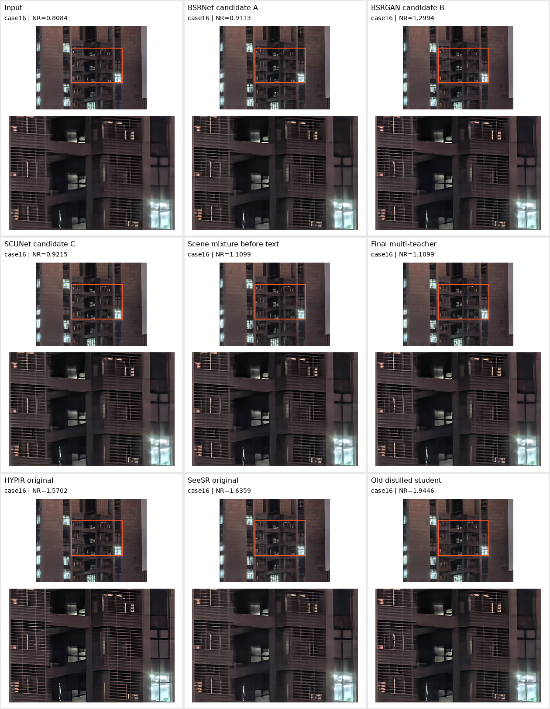

**人工复核：**原场景教师的部分格栅仍偏软；HYPIR/SeeSR 呈现出更细的线条，但仍需检查是否出现不规则网格。

| 版本 | NIQE↓ | MUSIQ↑ | MANIQA↑ | CLIPIQA↑ | 单图 NR↑ |
| --- | --- | --- | --- | --- | --- |
| `input_unmodified` | 9.2441 | 23.9854 | 0.2779 | 0.2150 | 0.8084 |
| `legacy_candidate_A` | 9.3208 | 27.2478 | 0.2988 | 0.2721 | 0.9113 |
| `legacy_candidate_B` | 7.0623 | 31.9012 | 0.2944 | 0.3922 | 1.2994 |
| `legacy_candidate_C` | 9.1032 | 27.4892 | 0.2949 | 0.2620 | 0.9215 |
| `legacy_scene_pretext` | 8.4682 | 30.3789 | 0.2939 | 0.3590 | 1.1099 |
| `legacy_scene_final` | 8.4682 | 30.3789 | 0.2939 | 0.3590 | 1.1099 |
| `hypir_sd2_t200` | 4.2004 | 29.9014 | 0.3017 | 0.3896 | 1.5702 |
| `seesr_50step` | 5.7990 | 30.4830 | 0.3654 | 0.5455 | 1.6359 |
| `pushv2_teacher_quality` | 5.7521 | 37.2171 | 0.3992 | 0.7484 | 1.9446 |

#### case18：发光招牌

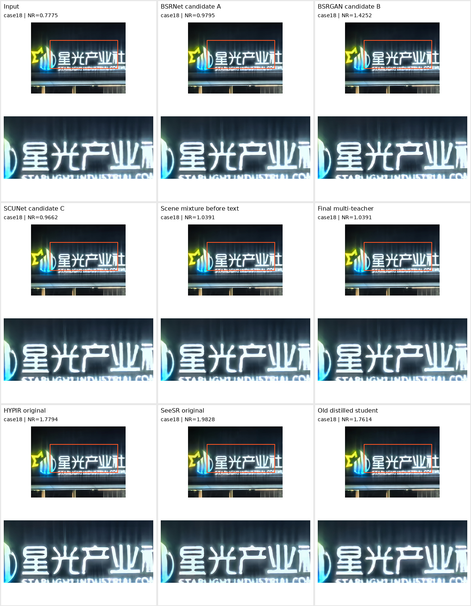

**人工复核：**多种策略仍保留了不规则的发光笔画；这是未解决案例，不能作为文字正确恢复的证明。

| 版本 | NIQE↓ | MUSIQ↑ | MANIQA↑ | CLIPIQA↑ | 单图 NR↑ |
| --- | --- | --- | --- | --- | --- |
| `input_unmodified` | 10.9025 | 17.7741 | 0.2916 | 0.3082 | 0.7775 |
| `legacy_candidate_A` | 10.9040 | 21.6845 | 0.3386 | 0.4240 | 0.9795 |
| `legacy_candidate_B` | 7.7317 | 28.1754 | 0.3276 | 0.5891 | 1.4252 |
| `legacy_candidate_C` | 10.6188 | 21.1739 | 0.3312 | 0.4233 | 0.9662 |
| `legacy_scene_pretext` | 10.0746 | 22.0220 | 0.3329 | 0.4860 | 1.0391 |
| `legacy_scene_final` | 10.0746 | 22.0220 | 0.3329 | 0.4860 | 1.0391 |
| `hypir_sd2_t200` | 5.7558 | 40.5549 | 0.3134 | 0.6360 | 1.7794 |
| `seesr_50step` | 7.5966 | 44.2314 | 0.4984 | 0.8018 | 1.9828 |
| `pushv2_teacher_quality` | 7.0707 | 27.8919 | 0.4092 | 0.7803 | 1.7614 |

#### case23：中式快餐文字

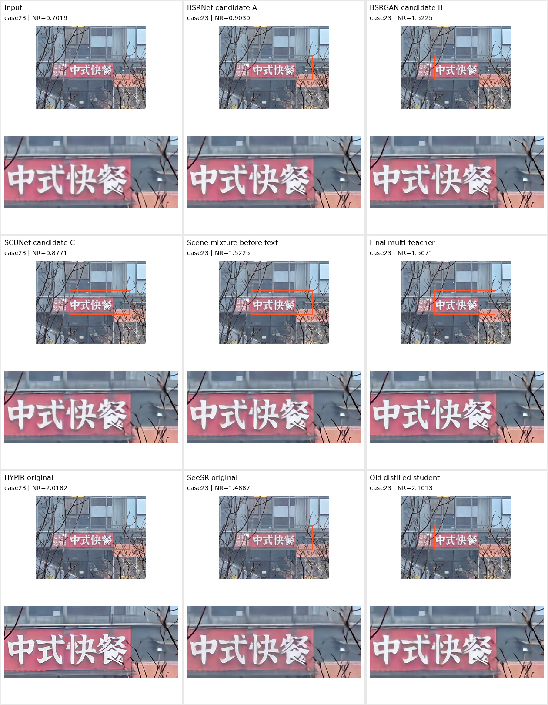

**人工复核：**文字融合后字边与红色底板有可见变化；还要检查穿过招牌的树枝遮挡是否保留。旧学生仍存在较粗的局部笔画。

| 版本 | NIQE↓ | MUSIQ↑ | MANIQA↑ | CLIPIQA↑ | 单图 NR↑ |
| --- | --- | --- | --- | --- | --- |
| `input_unmodified` | 9.5573 | 20.9745 | 0.2095 | 0.2384 | 0.7019 |
| `legacy_candidate_A` | 8.8739 | 28.8801 | 0.2434 | 0.2581 | 0.9030 |
| `legacy_candidate_B` | 7.2922 | 40.3906 | 0.2953 | 0.5525 | 1.5225 |
| `legacy_candidate_C` | 8.9564 | 27.8489 | 0.2423 | 0.2519 | 0.8771 |
| `legacy_scene_pretext` | 7.2922 | 40.3906 | 0.2953 | 0.5525 | 1.5225 |
| `legacy_scene_final` | 7.2754 | 39.2264 | 0.2950 | 0.5474 | 1.5071 |
| `hypir_sd2_t200` | 4.0856 | 48.2603 | 0.3380 | 0.6062 | 2.0182 |
| `seesr_50step` | 7.2003 | 43.5216 | 0.2840 | 0.4896 | 1.4887 |
| `pushv2_teacher_quality` | 6.0921 | 44.2398 | 0.4214 | 0.8468 | 2.1013 |

文字融合前后整图 NR：1.522512 → 1.507053，变化 -0.015459。这仍然不是局部 OCR 正确率。

#### case25：电信标识

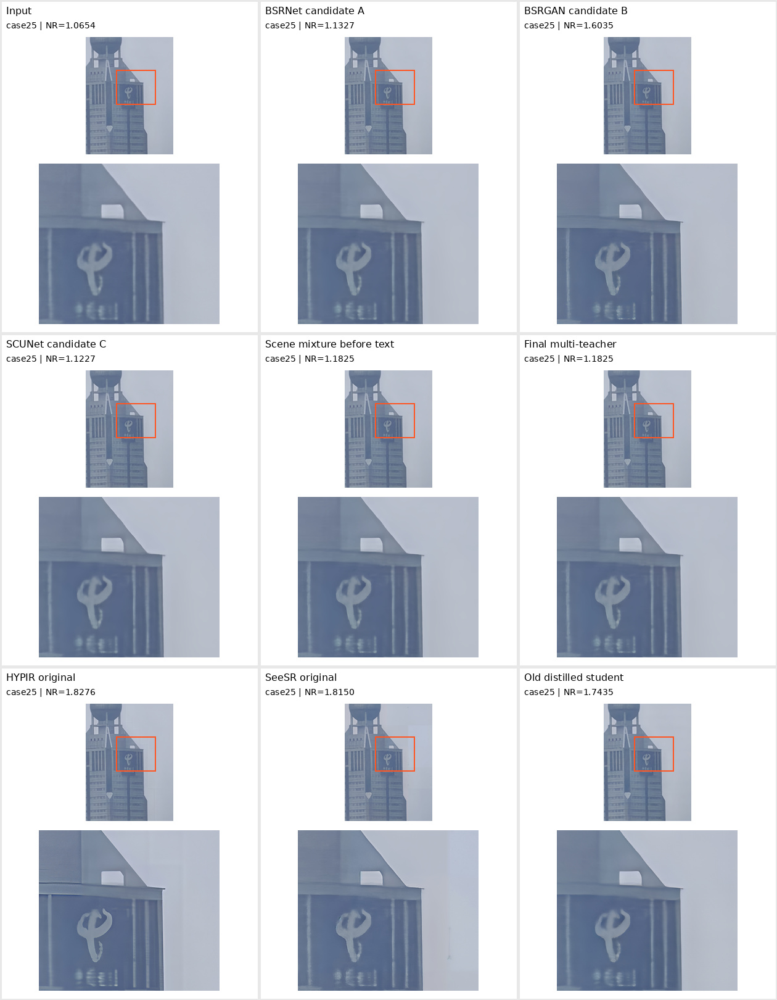

**人工复核：**标识有不同程度的锐化，但下方小字仍不可可靠辨读。最终教师没有采用已识别错误的文字专家结果。

| 版本 | NIQE↓ | MUSIQ↑ | MANIQA↑ | CLIPIQA↑ | 单图 NR↑ |
| --- | --- | --- | --- | --- | --- |
| `input_unmodified` | 11.5676 | 20.4155 | 0.3946 | 0.4666 | 1.0654 |
| `legacy_candidate_A` | 12.0676 | 24.1370 | 0.4019 | 0.4894 | 1.1327 |
| `legacy_candidate_B` | 6.5263 | 25.0237 | 0.4266 | 0.5793 | 1.6035 |
| `legacy_candidate_C` | 12.7592 | 22.7507 | 0.3995 | 0.4957 | 1.1227 |
| `legacy_scene_pretext` | 10.1987 | 23.5058 | 0.4081 | 0.5394 | 1.1825 |
| `legacy_scene_final` | 10.1987 | 23.5058 | 0.4081 | 0.5394 | 1.1825 |
| `hypir_sd2_t200` | 4.3626 | 31.7974 | 0.3793 | 0.5666 | 1.8276 |
| `seesr_50step` | 5.8536 | 27.5337 | 0.4257 | 0.6993 | 1.8150 |
| `pushv2_teacher_quality` | 7.9325 | 28.8837 | 0.4540 | 0.7939 | 1.7435 |

#### case28：树叶纹理

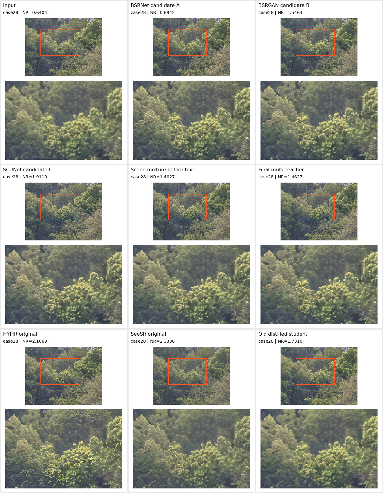

**人工复核：**历史场景教师的叶片纹理较温和，HYPIR/SeeSR 出现更多高频细节；没有 GT，不能判定新增叶片就是真实细节。

| 版本 | NIQE↓ | MUSIQ↑ | MANIQA↑ | CLIPIQA↑ | 单图 NR↑ |
| --- | --- | --- | --- | --- | --- |
| `input_unmodified` | 11.5996 | 20.0789 | 0.2605 | 0.1791 | 0.6404 |
| `legacy_candidate_A` | 10.5937 | 26.3198 | 0.2297 | 0.2013 | 0.6942 |
| `legacy_candidate_B` | 4.9971 | 36.0605 | 0.2659 | 0.4196 | 1.5464 |
| `legacy_candidate_C` | 4.6708 | 37.6367 | 0.3369 | 0.6648 | 1.9110 |
| `legacy_scene_pretext` | 5.5392 | 34.9094 | 0.2675 | 0.4001 | 1.4627 |
| `legacy_scene_final` | 5.5392 | 34.9094 | 0.2675 | 0.4001 | 1.4627 |
| `hypir_sd2_t200` | 2.7075 | 39.1694 | 0.3395 | 0.7064 | 2.1669 |
| `seesr_50step` | 3.3945 | 56.6923 | 0.4349 | 0.6712 | 2.3336 |
| `pushv2_teacher_quality` | 7.0664 | 29.6104 | 0.3059 | 0.8357 | 1.7310 |

#### case41：花瓣与叶片

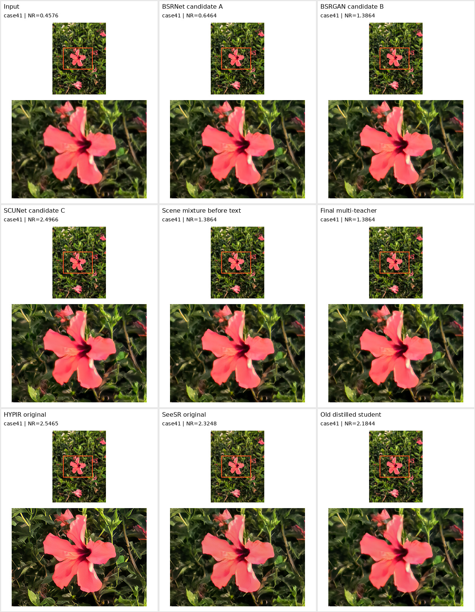

**人工复核：**HYPIR 的叶片更清楚；旧学生与 C 候选的花瓣轮廓与输入有观感差异，且 C 的输入是旧192输出，不应作为同输入公平对比。

| 版本 | NIQE↓ | MUSIQ↑ | MANIQA↑ | CLIPIQA↑ | 单图 NR↑ |
| --- | --- | --- | --- | --- | --- |
| `input_unmodified` | 10.0547 | 16.4784 | 0.1290 | 0.1638 | 0.4576 |
| `legacy_candidate_A` | 9.6757 | 25.0510 | 0.1536 | 0.2098 | 0.6464 |
| `legacy_candidate_B` | 7.4387 | 40.6898 | 0.1876 | 0.5358 | 1.3864 |
| `legacy_candidate_C` | 4.0618 | 52.0042 | 0.5084 | 0.8743 | 2.4966 |
| `legacy_scene_pretext` | 7.4387 | 40.6898 | 0.1876 | 0.5358 | 1.3864 |
| `legacy_scene_final` | 7.4387 | 40.6898 | 0.1876 | 0.5358 | 1.3864 |
| `hypir_sd2_t200` | 3.1407 | 52.9623 | 0.4837 | 0.8473 | 2.5465 |
| `seesr_50step` | 4.0878 | 54.0574 | 0.3883 | 0.8048 | 2.3248 |
| `pushv2_teacher_quality` | 5.7094 | 56.8878 | 0.3161 | 0.8703 | 2.1844 |

### 10.7 原始数据与复核入口

- 本节汇总：[`legacy_teacher_metrics.csv`](legacy_teacher_metrics.csv)。
- 各组逐图测量及汇总：[`legacy_teachers/evaluation/`](legacy_teachers/evaluation/)。
- 新服务器原教师图评分副本：`/cache/independent_sr_round2_20261010/legacy_teachers/images/`。
- 原服务器最终教师原件：`/root/autodl-tmp/independent_sr/30_our_work/runs/finalize_scene_teachers_20260919/images/`。
- 融合前、最终教师的每图配方分别保存在对应 selection.json；没有把模型候选A/B/C误写成最终教师，也没有用教师分数代替学生分数。
